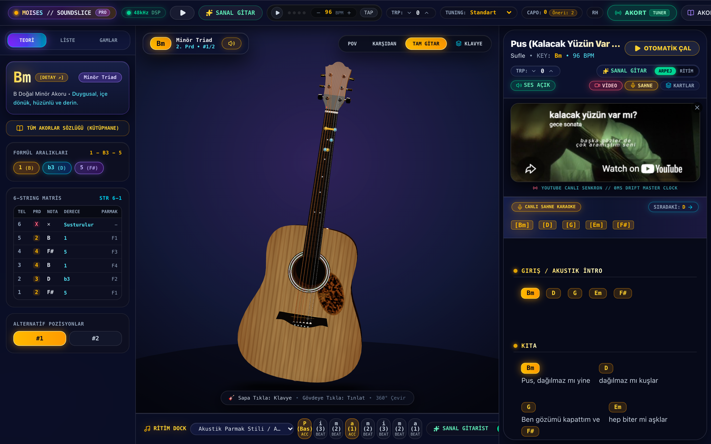
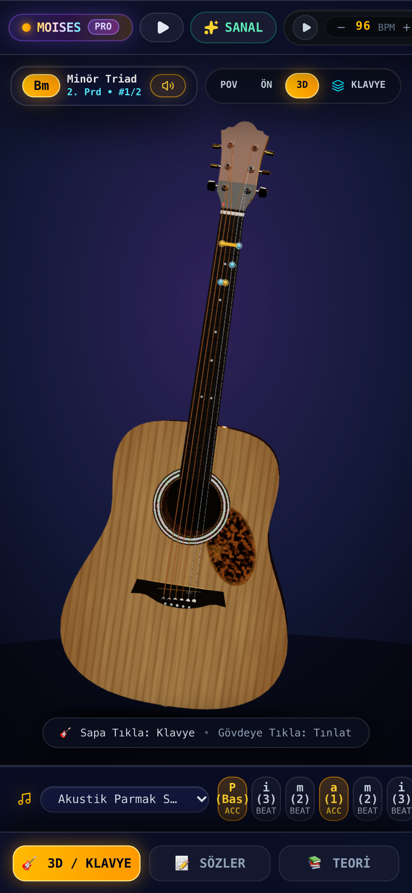

# 🎸 Gitar Akor Pro — Guitar Chord & Fretboard Studio

**Modern, interaktif ve AI destekli gitar akor & şarkı çalma asistanı.**

Herhangi bir şarkının akorlarını canlı bir **3D gitar ve fretboard** üzerinde; parmak pozisyonları, bare basışları ve gerçek akustik tel tınısıyla senkronize gösterir. Şarkı internette olmasa bile yapay zeka armoni analizi ile akorları anında üretir.

[](https://guitar-chord-app-three.vercel.app)
[](https://react.dev)
[](https://www.typescriptlang.org)
[](https://vite.dev)
[](https://tailwindcss.com)
[](#-4-saat-challenge)

🔗 **Live:** https://guitar-chord-app-three.vercel.app

---

## 📸 Ekran Görüntüleri



<p align="center">
  
</p>

---

## ⚡ 4 Saat Challenge

> **Bu proje tek bir 4 saatlik challenge sprint'inde, sıfırdan inşa edildi.** Şablon yok, hazır boilerplate yok, kopyala-yapıştır proje iskeleti yok — sadece ham kod, müzik teorisi ve fizik modellemesi.

Tek oturumda çıkanlar:

- ✅ **Sıfırdan 3D gitar sahnesi** — Three.js / React Three Fiber ile prosedürel akustik gitar modeli
- ✅ **Karplus-Strong akustik tel sentezi** — tek satır ses dosyası olmadan, saf Web Audio fiziksel modelleme
- ✅ **Fretboard motoru** — 6 tel × 14 perde, parmak/bare/derece matrisi, solak mod, çoklu pozisyon
- ✅ **ChordPro oynatıcı** — transpoze, kapo, otomatik kaydırma, akor rozetleri
- ✅ **AI armoni analizi** — bilinmeyen şarkılar için akor üretimi + iki satırlı tab parser
- ✅ **YouTube 0ms drift canlı senkron** — milisaniyelik karaoke hizalaması
- ✅ **Metronom + Ritim Dock + mobil UI** — 220 BPM'e kadar, tamamen responsive

**Süre: 4 saat. Kod: production. Bahane: yok.** 🎸

---

## ✨ Özellikler

### 1. 🎸 İnteraktif 3D Gitar & Fretboard
- **6 Tel & 14 Perde**: Standart E-A-D-G-B-e akort, sedef perde işaretleri (3, 5, 7, 9, 12 çift nokta).
- **Parmak & Bare Gösterimi**: Hangi parmağın hangi tele basacağını gösteren numaralar (1-4) ve bare akor şeritleri.
- **Boş & Kapalı Teller**: Boş tınlayacak teller (`O`) ve çalınmayacak teller (`✕`).
- **Görünüm Modları**: Parmak Numaraları veya Nota İsimleri (C, D, E...) arasında tek tıkla geçiş.
- **Solak Gitarist Desteği**: Solaklar için ayna görüntüsü modu.
- **Çoklu Pozisyon Seçimi**: Aynı akorun farklı pozisyonları (örn. Açık Am vs 5. perde Bare Am).

### 2. 🔊 Web Audio API Gerçekçi Akustik Tel Sentezi (Karplus-Strong)
- Sıfır dış bağımlılık veya ses dosyası yükleme gecikmesi.
- Karplus-Strong fiziksel modelleme algoritması ile gerçek akustik tel titreşimi ve rezonansı.
- **Strum (Akor Tarama)**: Akor basıldığında tellerin 28ms gecikmeyle aşağı doğru doğal taranması.
- **Tek Tel Vuruşu**: Gitardaki herhangi bir tele veya perdeye tıklandığında o notanın anında çalınması.

### 3. 🎵 ChordPro Oynatıcı & Senkronize Sözler
- Şarkı sözleri üzerindeki akor rozetleri.
- Akora tıklandığında gitar sapı anında o akora geçer ve akoru tınlatır.
- **Transpoze Motoru**: Tek tıkla şarkıyı `+1` / `-1` yarım ses yukarı/aşağı taşıma.
- **Otomatik Kaydırma (Auto-Scroll)**: Ayarlanabilir hız ile şarkı çalarken sayfanın eller serbest aşağı kayması.
- **Kapo (Capo) Desteği**: Kapo perde tavsiyesi ve ton eşlemesi.
- **YouTube Canlı Senkron**: 0ms drift master clock ile video çalarken sözler ve akorlar milisaniyelik senkron akar.

### 4. 🧠 Yapay Zeka (AI) Akor Çıkarıcı & Akıllı Arama
- **Yeni / Bilinmeyen Şarkılar**: Şarkı internette hiç bulunmasa bile yapay zeka müzik teorisi ve armoni analiziyle tonu, kıta ve nakarat akor döngüsünü otomatik üretir.
- **İki Satırlı Tab & Metin Yapıştırma**: Ultimate Guitar veya AkorMerkezi'nden kopyalanan iki satırlı akor-söz metinlerini otomatik algılayıp ChordPro formatına dönüştürür.
- **Kalıcı Hafıza**: Eklenen özel şarkılar LocalStorage'da saklanır.

### 5. ⏱️ Dahili Metronom
- 40 - 220 BPM arası tempo ayarı.
- 4/4 zamanlı görsel vuruş animasyonu ve akustik metronom klik sesi.

---

## 🛠️ Teknoloji Yığını
- **Frontend**: React 19, TypeScript, Vite
- **Stil**: Tailwind CSS v4, Lucide React Icons
- **3D**: Three.js / React Three Fiber gitar sahnesi
- **Ses Motoru**: Web Audio API (Native Karplus-Strong physical modeling)
- **Doğrulama**: Iris Visual Testing

---

## 🚀 Hızlı Başlangıç

```bash
# Projeyi klonlayın
git clone https://github.com/brkNx/guitar-chord-app.git

# Dizinine girin
cd guitar-chord-app

# Bağımlılıkları yükleyin
npm install

# Geliştirici sunucusunu başlatın
npm run dev
```

Tarayıcınızda `http://localhost:5173` adresine gidin.

---

## 📦 Üretim Derlemesi

```bash
npm run build
npm run preview
```

---

## 🌐 Deployment

Vercel üzerinde otomatik deploy:

- **Production**: https://guitar-chord-app-three.vercel.app
- **Branch Preview**: commit push edildiğinde otomatik preview URL üretilir.

---

<p align="center">
  <b>🎸 Build. Strum. Repeat.</b>
</p>
